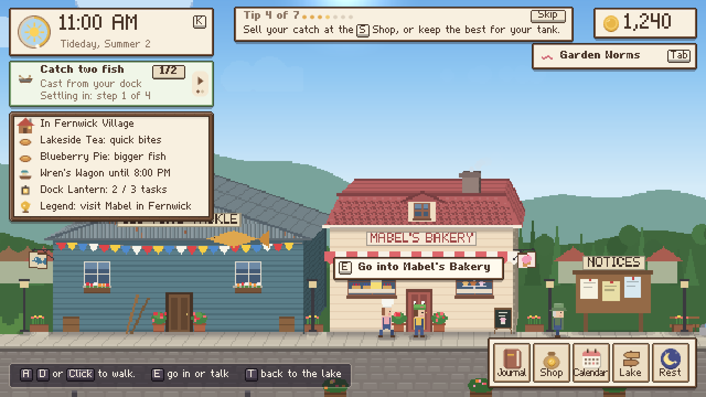

# Lantern Lake


Cast from the dock with Biscuit the cat at your side. When the bobber dips, set the hook and follow the fish through its lunges. That first catch could become dinner, a gift for a neighbour, or the newest resident of Fernwick Aquarium.

Grandma Rosie once tended four lanterns around the lake. Each wakes in a different season. As you get to know Fernwick, you'll learn what it takes to light them again. Follow the river to Saltmarsh for sea fishing, changing tides, and a harbour full of new neighbours. Fish at your own pace, or invite up to three friends to share the dock.

**[Download for Windows](https://github.com/lilMarkoo/lantern-lake/releases/latest)** · [Run from source](#run-from-source) · [Player guide](docs/player-guide.md) · [Co-op setup](docs/player-guide.md#playing-together)

## What’s new

The latest update, **0.3.2**, brings a closer camera, wind moving through the trees and across the water, quicker fights with small fish, and better odds of finding a species you haven’t caught. Stay for the evening rise, when fish feed more eagerly, and watch your dock fill with keepsakes as your catches add up.

Recent updates also let you:

- **Follow the river to Saltmarsh.** Fish the pier and Kelp Rocks, plan around the tides, meet the harbour folk, and help Sol restore the coastal lighthouse.
- **Walk through your collection.** Donated fish swim in twelve themed aquarium exhibits, with benches, visiting neighbours, and rewards for completing tanks.
- **Settle into life at the lake.** Follow the first-day welcome quest, pin a goal with **Q**, or tune into three radio stations with **R**.
- **Read the water.** Twitch your bobber, cast into feeding schools, and learn how circlers, divers, and sulkers fight. Line sounds and controller rumble help you feel the strain.

[Read the latest release notes](https://github.com/lilMarkoo/lantern-lake/releases/latest)

## Around the lake and down the river

| On the water | In Fernwick |
| --- | --- |
|  |  |
| **Land your catch.** Keep the golden arc on the fish and ease off when it lunges. | **Walk into town.** Pick up a recipe at Mabel’s Bakery or see what the neighbours are asking for on the notice board. |
|  |  |
| **Cook what you catch.** Time the flip at your cabin stove, then plate the dish. | **Come back after dark.** Help Fernwick build its lighthouse and watch for rare fish by its light. |

| Saltmarsh harbour | Fernwick Aquarium |
| --- | --- |
|  |  |
| **Take a trip downriver.** Meet the harbour folk, check the tide, and find your next sea catch. | **Visit your discoveries.** Walk past the fish you’ve donated and work toward completing each exhibit. |

*Screenshots captured from the game, with progressed collections and unlocks shown.*

## Play on Windows

1. Open the [latest release](https://github.com/lilMarkoo/lantern-lake/releases/latest) and download the full **LanternLake-…-windows.zip** under **Assets**.
2. Extract the ZIP and open **LanternLake.exe**. The launcher checks for updates.
3. Choose **Play**. At the dock, hold **Space** or the **left mouse button** to wind up, then release to cast. Wait for the bobber to go under before you hook the fish.

## Run from source

The game draws its pixel art and synthesizes its soundtrack in Python. From the repository folder, run the following with Python 3 installed.

```sh
python -m pip install pygame-ce numpy
python main.py
```

## Field guide

- [Keyboard and controller controls](docs/player-guide.md#controls)
- [Your first day](docs/player-guide.md#your-first-day), [goals](docs/player-guide.md#goals-q), and [the radio](docs/player-guide.md#the-radio-r)
- [Reeling](docs/player-guide.md#reeling) and [waiting for a bite](docs/player-guide.md#waiting-for-a-bite)
- [Rowboat routes and fishing spots](docs/player-guide.md#the-rowboat-and-fishing-spots)
- [Saltmarsh and the tides](docs/player-guide.md#saltmarsh-down-the-river), [the harbour](docs/player-guide.md#the-harbour), and [the coastal lighthouse](docs/player-guide.md#the-lighthouse)
- [The aquarium](docs/player-guide.md#the-aquarium) and [shoreline projects](docs/player-guide.md#the-shoreline)
- [Seasonal legends](docs/player-guide.md#legends-of-the-lake) and [festival calendar](docs/player-guide.md#the-calendar)
- [Biscuit](docs/player-guide.md#biscuit), [the cabin garden](docs/player-guide.md#the-garden) and [wildlife photography](docs/player-guide.md#wildlife-and-the-nature-page)
- [Developer checks](docs/player-guide.md#developer-checks) and [release workflow](docs/player-guide.md#releasing-an-update)
