# Lantern Lake

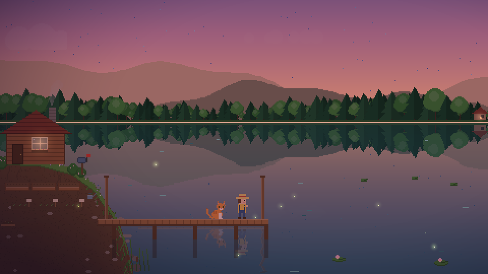

Cast from the dock with Biscuit the cat at your side. When the bobber dips, set the hook and follow the fish through its lunges. That first catch could become dinner, a gift for a neighbour, or the newest resident of Fernwick Aquarium.

Grandma Rosie once tended four lanterns around the lake. Each wakes in a different season. As you get to know Fernwick, you'll learn what it takes to light them again. Follow the river to Saltmarsh for sea fishing, changing tides, and a harbour full of new neighbours. Fish at your own pace, or invite up to three friends to share the dock.

**[Download for Windows](https://github.com/lilMarkoo/lantern-lake/releases/latest)** · [Run from source](#run-from-source) · [Player guide](docs/player-guide.md) · [Co-op setup](docs/player-guide.md#playing-together)

## What’s new

The latest update, **0.4.0**, takes you across the lake to **the Far Shore**. Mend the old landing, row over to the woodland trail, and meet Bramwell the forest ranger. Gather seasonal wild finds, cook supper by the fire, sleep under canvas, and return after dark to fish the Hollow Pool. The Far Shore is a solo adventure.

| Along the woodland trail | After dark |
| --- | --- |
| 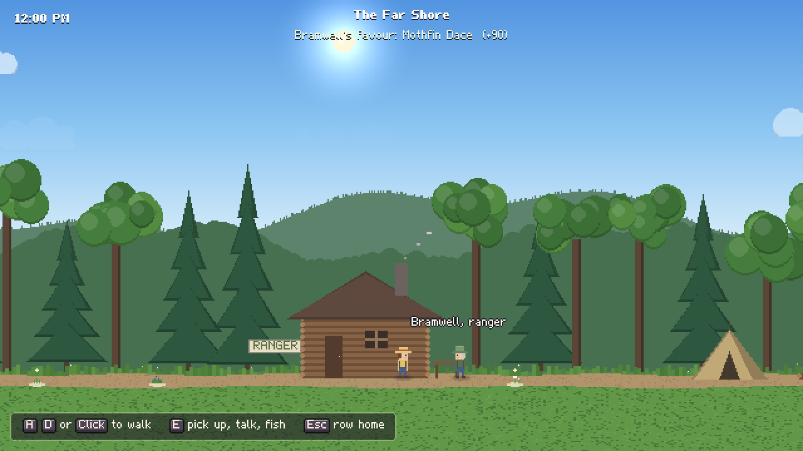 | 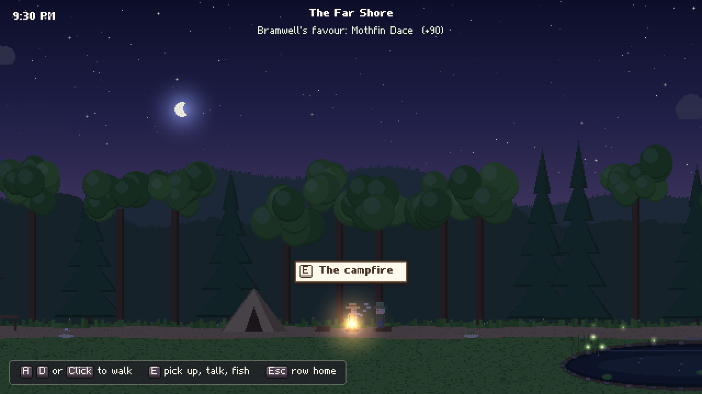 |
| **Meet Bramwell.** Help with a daily favour and gather wild finds to sell or cook. | **Stay by the fire.** Roast supper, brew forager’s tea, or sleep in the tent and head home at dawn. |

- **Five fish in the Hollow Pool.** Cast between 7:30 PM and 5 AM for the Mothfin, Moonperch, Mossback Tench, and Wisp Eel. Help Bramwell restore the Hollow Lantern to bring out the Hollow King.
- **Join the Angling Club.** Every Lanternday from 5 to 7 PM, fish at any lake spot against Marlo, Dottie, Ferris, and Old Hen. Weekly rules alternate between the biggest fish and the most species. Earn ribbons, coins, and a winner’s cup, then read Marlo’s letter with the results.
- **Navigate with the d-pad.** Jump directly between cards, buttons, and beds in the Trading Post, garden, hatchery, journal, and cabin.
- **A calmer view.** Slimmer event cards, one notification at a time, and a radio that expands when the host speaks leave more room for the lake. The journal’s five fish pages now show collection counts across the top.
- **Four new badges and update notes.** Track your foraging, camping, lantern restoration, and club victories. A What’s new card introduces each update, and shell swaps now draw from your spare shells across different kinds.

[Far Shore guide](docs/player-guide.md#the-far-shore) · [Angling Club guide](docs/player-guide.md#the-angling-club) · [Latest release notes](https://github.com/lilMarkoo/lantern-lake/releases/latest)

## Life around the cabin

| The Trading Post | Your garden |
| --- | --- |
| 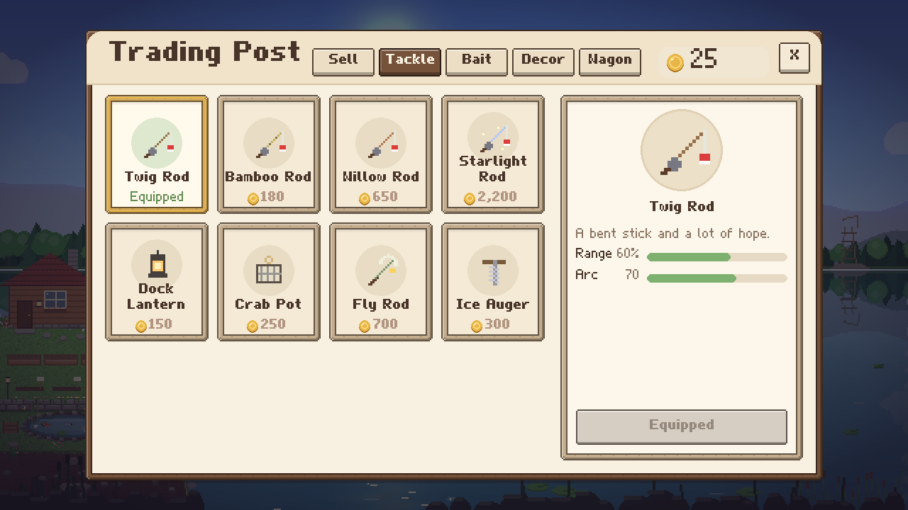 | 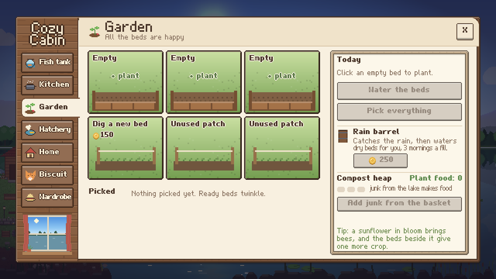 |
| **Choose your next upgrade.** Browse cards on a shelf, inspect a rod’s range and arc, or check your bait supply before buying. | **Tend each bed.** Spot thirsty crops by their water drops and ready harvests by their twinkles. |

Blooming sunflowers bring bees that boost nearby harvests, and a rain barrel helps water dry beds. Down on the lower terrace, fish wander through the hatchery pond while fry dart among the reeds. Plant every empty bed at once, sell your produce, and watch the path lamps come on at night.

[Garden guide](docs/player-guide.md#the-garden) · [HUD and shop guide](docs/player-guide.md#the-hud)

## Go deeper, grow your collection

Explore **the Drowned Stair**, introduced in 0.3.8, beneath the hill by your dock. Start with your hands and a bit of string, catch fish to open the next stair, and find better gear as you descend. A boss guards every fifth floor. At camp, choose whether to cash in your haul or head deeper. Lose your last heart and the run’s loot is gone.

| Beneath the lake | Beside the cabin |
| --- | --- |
| 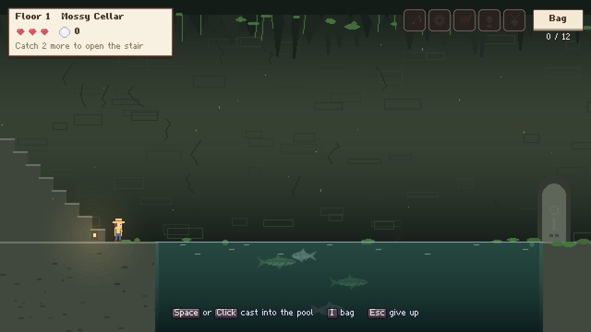 | 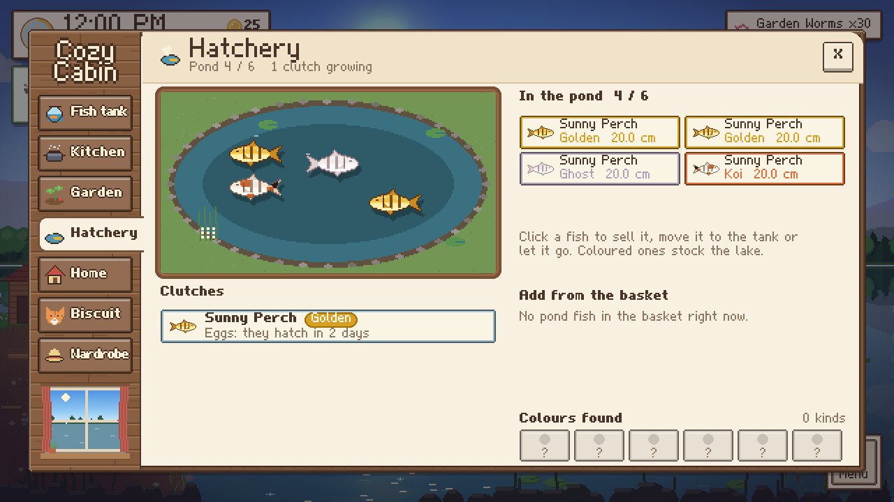 |
| **Pack for the next floor.** Find rods, reels, lines, lures, charms, and supplies for your twelve-slot bag. | **Raise your own fish.** Keep a breeding pair, hatch their eggs, and discover which colours the young inherit. |

- **Six rare colour morphs.** Look for golden, ghost, shadow, koi, starry, and prism fish. Release a morph to make that species and colour more likely to bite for a week.
- **A roomier cabin.** Browse tabs down the side of a new cabin window with a view of the lake, including the hatchery pond.
- **Four new badges.** Raise your first clutch, discover every morph, beat your first dungeon boss, and reach floor 20.

[Explore the Drowned Stair](docs/player-guide.md#the-drowned-stair) · [Learn about morphs and the hatchery](docs/player-guide.md#colour-morphs-and-the-hatchery)

## Make yourself at home

Make your own angler with skin, hair, eyes, a beard, and an outfit. Add a keepsake charm for your rod, a fishing mood, and a coat for Biscuit. Preview your look at different times and in every season, change it later in the cabin’s Wardrobe, and share it with friends when you fish together.

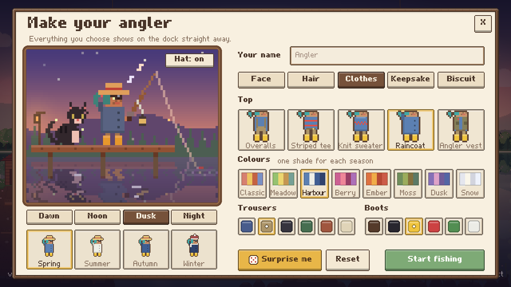

Display options include sharp scaling when resizing or using fullscreen, accelerated rendering, and frame-rate limits up to 144 fps. A new [Pixel scaling option](docs/player-guide.md#options) keeps pixels perfectly square or fills the screen. On older computers, the Auto light effects setting trims the extra glow by itself when the game starts to fall behind.

Recent updates also let you:

- **Make each spot your own.** Lily Cove closes in under a willow, the Deep opens onto a hazy far shore, and Willow Creek runs quick between its banks. Row there and watch your boat cross the lake.
- **Wake up to the light.** Low sun throws beams across the water, mist lies on the lake at first light, lanterns glow after dark, and on clear nights the Milky Way shows in the still water.
- **Play together with a room code.** Open your lake online and share a short code like K7Q2-M9XT, with no router settings. See [Co-op setup](docs/player-guide.md#playing-together).
- **Feel every fight.** The hooked fish thrashes big and colourful under your line, with the reel ring as a small readout in the corner.
- **Light the lanterns at dusk.** Light the wick yourself as the evening comes on and watch Fernwick’s windows answer across the water.
- **Spend time in Fernwick.** Sit on the lookout bench with Biscuit, watch Mabel fetch your bread at the bakery, and collect letters from your mailbox when you’re ready to read them.
- **Fish four different places.** At The Deep, hooked fish bolt for the bottom. At Lily Cove, the lily stems can snag your line. Willow Creek’s current carries your bobber, and a kingfisher sometimes visits your own dock post.
- **Make each day count.** You get a fresh tin of 30 worms every morning (dig for more at the dock if you run out), and a rare fish that escapes stays spooked until tomorrow.
- **Follow the river to Saltmarsh.** Fish the pier and Kelp Rocks, plan around the tides, meet the harbour folk, and help Sol restore the coastal lighthouse.
- **Walk through your collection.** Donated fish swim in twelve themed aquarium exhibits, with benches, visiting neighbours, and rewards for completing tanks.

## Around the lake and down the river

| On the water | In Fernwick |
| --- | --- |
| 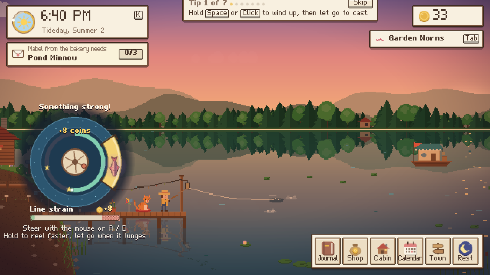 |  |
| **Land your catch.** Watch the fish fight on the line, keep the golden arc on it, and ease off when it lunges. | **Walk into town.** Pick up a recipe at Mabel’s Bakery or see what the neighbours are asking for on the notice board. |
|  |  |
| **Cook what you catch.** Time the flip at your cabin stove, then plate the dish. | **Come back after dark.** Help Fernwick build its lighthouse and watch for rare fish by its light. |
| 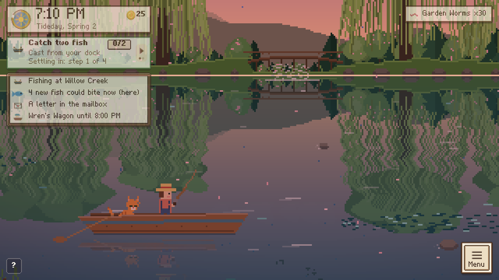 | 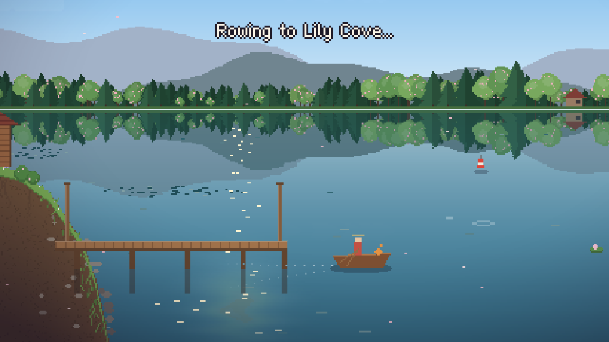 |
| **Try a new spot.** Each one looks and fishes differently, from the lily-choked cove to the willow-lined creek. | **Row across the lake.** Watch your boat pull across the water, leaving a wake behind it. |

| Saltmarsh harbour | Fernwick Aquarium |
| --- | --- |
| 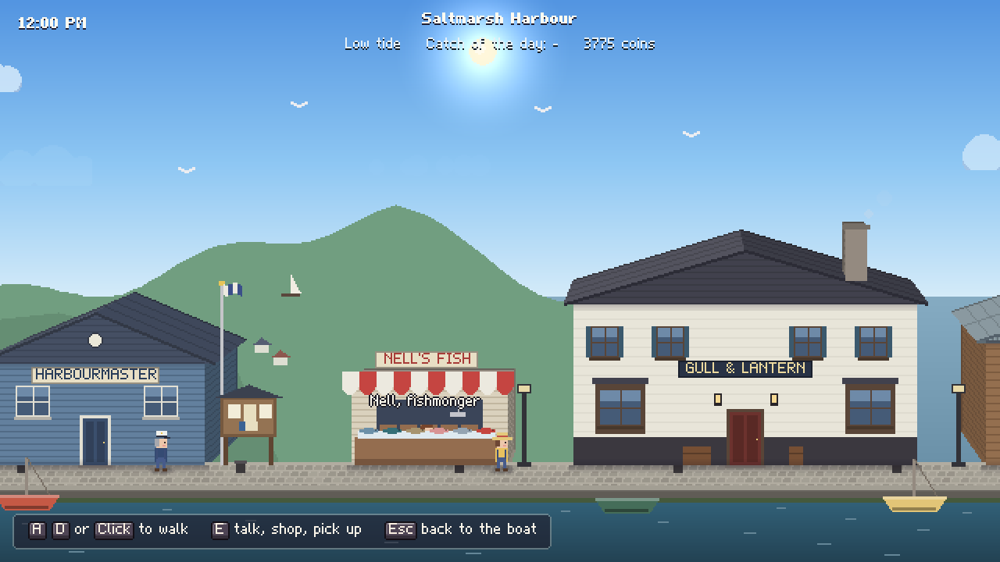 |  |
| **Take a trip downriver.** Meet the harbour folk, check the tide, and find your next sea catch. | **Visit your discoveries.** Walk past the fish you’ve donated and work toward completing each exhibit. |

*Screenshots captured from the game, with progressed collections and unlocks shown.*

## Play on Windows

1. Open the [latest release](https://github.com/lilMarkoo/lantern-lake/releases/latest) and download the full **LanternLake-…-windows.zip** under **Assets**.
2. Extract the ZIP and open **LanternLake.exe**. The launcher checks for updates.
3. Choose **Play**. At the dock, hold **Space** or the **left mouse button** to wind up, then release to cast. Wait for the bobber to go under before you hook the fish.

## Run from source

The game draws its pixel art and synthesizes its soundtrack in Python. From the repository folder, run the following with Python 3 installed.

```sh
python -m pip install pygame-ce numpy
python main.py
```

## Field guide

- [Keyboard and controller controls](docs/player-guide.md#controls) and [display options](docs/player-guide.md#options)
- [Making your angler](docs/player-guide.md#making-your-angler) and [your cabin](docs/player-guide.md#your-cabin)
- [The Drowned Stair](docs/player-guide.md#the-drowned-stair), [colour morphs, and the hatchery](docs/player-guide.md#colour-morphs-and-the-hatchery)
- [Your first day](docs/player-guide.md#your-first-day), [goals](docs/player-guide.md#goals-q), and [the radio](docs/player-guide.md#the-radio-r)
- [Reeling](docs/player-guide.md#reeling), [waiting for a bite](docs/player-guide.md#waiting-for-a-bite), and [the worm tin](docs/player-guide.md#the-worm-tin)
- [Rowboat routes and fishing spots](docs/player-guide.md#the-rowboat-and-fishing-spots) and [the Far Shore](docs/player-guide.md#the-far-shore)
- [Saltmarsh and the tides](docs/player-guide.md#saltmarsh-down-the-river), [the harbour](docs/player-guide.md#the-harbour), and [the coastal lighthouse](docs/player-guide.md#the-lighthouse)
- [The aquarium](docs/player-guide.md#the-aquarium) and [shoreline projects](docs/player-guide.md#the-shoreline)
- [Seasonal legends](docs/player-guide.md#legends-of-the-lake), [festival calendar](docs/player-guide.md#the-calendar), and [the Angling Club](docs/player-guide.md#the-angling-club)
- [Biscuit](docs/player-guide.md#biscuit), [the cabin garden](docs/player-guide.md#the-garden) and [wildlife photography](docs/player-guide.md#wildlife-and-the-nature-page)
- [Developer checks](docs/player-guide.md#developer-checks) and [release workflow](docs/player-guide.md#releasing-an-update)
