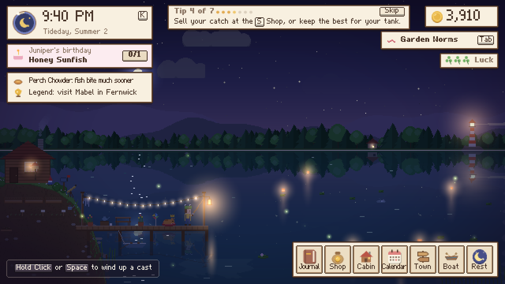
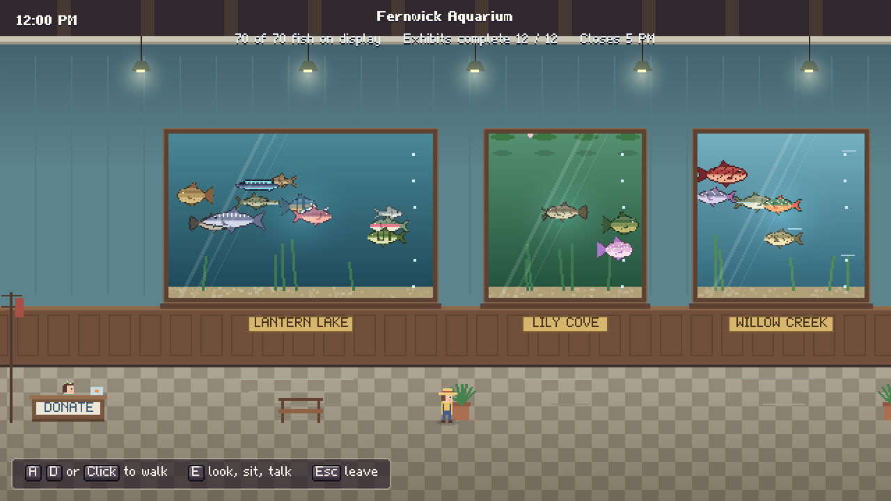

# Lantern Lake


Cast from the dock with Biscuit the cat at your side. When the bobber dips, set the hook and follow the fish through its lunges. That first catch could become dinner, a gift for a neighbour, or the newest resident of Fernwick Aquarium.

Grandma Rosie once tended four lanterns around the lake. Each wakes in a different season. As you get to know Fernwick, you'll learn what it takes to light them again. Follow the river to Saltmarsh for sea fishing, changing tides, and a harbour full of new neighbours. Fish at your own pace, or invite up to three friends to share the dock.

**[Download for Windows](https://github.com/lilMarkoo/lantern-lake/releases/latest)** · [Run from source](#run-from-source) · [Player guide](docs/player-guide.md) · [Co-op setup](docs/player-guide.md#playing-together)

## What’s new

The latest update, **0.3.7**, lets you **make your own angler**. Before your first cast, choose your skin, hair, eyes, beard and outfit. Your colours shift with the seasons. Add a keepsake charm for your rod, a fishing mood, and a coat for Biscuit. Everything shows straight away in a little dock scene that you can try at dawn, noon, dusk or night and in any season. You can change your look any time from the cabin’s Wardrobe, and friends see it when you fish together.


The picture stays crisp now. The game no longer goes blurry when you resize the window, go fullscreen, or move to another monitor. It also draws through your graphics card, so it runs smoothly up to 144 fps. A new [Pixel scaling option](docs/player-guide.md#options) keeps pixels perfectly square or fills the screen. On older computers, the Auto light effects setting trims the extra glow by itself when the game starts to fall behind.

Recent updates also let you:

- **Make each spot your own.** Lily Cove closes in under a willow, the Deep opens onto a hazy far shore, and Willow Creek runs quick between its banks. Row there and watch your boat cross the lake.
- **Wake up to the light.** Low sun throws beams across the water, mist lies on the lake at first light, lanterns glow after dark, and on clear nights the Milky Way shows in the still water.
- **Play together with a room code.** Open your lake online and share a short code like K7Q2-M9XT, with no router settings. See [Co-op setup](docs/player-guide.md#playing-together).
- **Feel every fight.** The hooked fish thrashes big and colourful under your line, with the reel ring as a small readout in the corner.
- **Light the lanterns at dusk.** Light the wick yourself as the evening comes on and watch Fernwick’s windows answer across the water.
- **Spend time in Fernwick.** Sit on the lookout bench with Biscuit, watch Mabel fetch your bread at the bakery, and collect letters from your mailbox when you’re ready to read them.
- **Fish four different places.** At The Deep, hooked fish bolt for the bottom. At Lily Cove, the lily stems can snag your line. Willow Creek’s current carries your bobber, and a kingfisher sometimes visits your own dock post.
- **Make each day count.** You get a fresh tin of 30 worms every morning (dig for more at the dock if you run out), and a rare fish that escapes stays spooked until tomorrow.
- **Follow the river to Saltmarsh.** Fish the pier and Kelp Rocks, plan around the tides, meet the harbour folk, and help Sol restore the coastal lighthouse.
- **Walk through your collection.** Donated fish swim in twelve themed aquarium exhibits, with benches, visiting neighbours, and rewards for completing tanks.

[Read the latest release notes](https://github.com/lilMarkoo/lantern-lake/releases/latest)

## Around the lake and down the river

| On the water | In Fernwick |
| --- | --- |
|  |  |
| **Land your catch.** Watch the fish fight on the line, keep the golden arc on it, and ease off when it lunges. | **Walk into town.** Pick up a recipe at Mabel’s Bakery or see what the neighbours are asking for on the notice board. |
|  |  |
| **Cook what you catch.** Time the flip at your cabin stove, then plate the dish. | **Come back after dark.** Help Fernwick build its lighthouse and watch for rare fish by its light. |
|  |  |
| **Try a new spot.** Each one looks and fishes differently, from the lily-choked cove to the willow-lined creek. | **Row across the lake.** Watch your boat pull across the water, leaving a wake behind it. |

| Saltmarsh harbour | Fernwick Aquarium |
| --- | --- |
|  |  |
| **Take a trip downriver.** Meet the harbour folk, check the tide, and find your next sea catch. | **Visit your discoveries.** Walk past the fish you’ve donated and work toward completing each exhibit. |

*Screenshots captured from the game, with progressed collections and unlocks shown.*

## Play on Windows

1. Open the [latest release](https://github.com/lilMarkoo/lantern-lake/releases/latest) and download the full **LanternLake-…-windows.zip** under **Assets**.
2. Extract the ZIP and open **LanternLake.exe**. The launcher checks for updates.
3. Choose **Play**. At the dock, hold **Space** or the **left mouse button** to wind up, then release to cast. Wait for the bobber to go under before you hook the fish.

## Run from source

The game draws its pixel art and synthesizes its soundtrack in Python. From the repository folder, run the following with Python 3 installed.

```sh
python -m pip install pygame-ce numpy
python main.py
```

## Field guide

- [Keyboard and controller controls](docs/player-guide.md#controls) and [display options](docs/player-guide.md#options)
- [Making your angler](docs/player-guide.md#making-your-angler)
- [Your first day](docs/player-guide.md#your-first-day), [goals](docs/player-guide.md#goals-q), and [the radio](docs/player-guide.md#the-radio-r)
- [Reeling](docs/player-guide.md#reeling), [waiting for a bite](docs/player-guide.md#waiting-for-a-bite), and [the worm tin](docs/player-guide.md#the-worm-tin)
- [Rowboat routes and fishing spots](docs/player-guide.md#the-rowboat-and-fishing-spots)
- [Saltmarsh and the tides](docs/player-guide.md#saltmarsh-down-the-river), [the harbour](docs/player-guide.md#the-harbour), and [the coastal lighthouse](docs/player-guide.md#the-lighthouse)
- [The aquarium](docs/player-guide.md#the-aquarium) and [shoreline projects](docs/player-guide.md#the-shoreline)
- [Seasonal legends](docs/player-guide.md#legends-of-the-lake) and [festival calendar](docs/player-guide.md#the-calendar)
- [Biscuit](docs/player-guide.md#biscuit), [the cabin garden](docs/player-guide.md#the-garden) and [wildlife photography](docs/player-guide.md#wildlife-and-the-nature-page)
- [Developer checks](docs/player-guide.md#developer-checks) and [release workflow](docs/player-guide.md#releasing-an-update)
