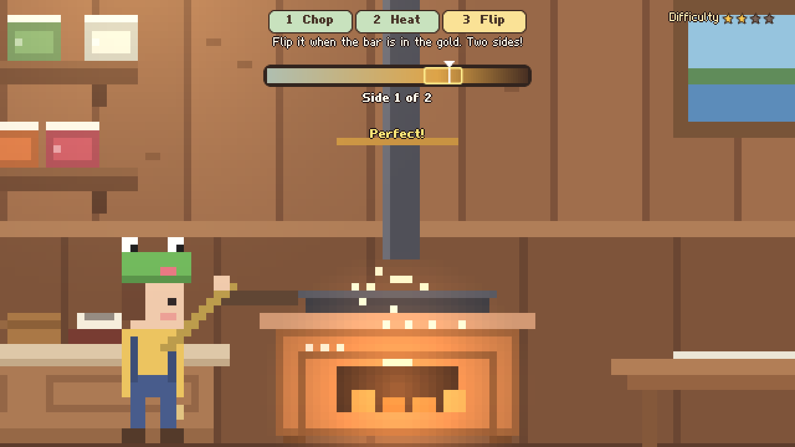

# Lantern Lake


Cast from the dock with Biscuit the cat at your side. When the bobber dips, set the hook and follow the fish through its lunges. That first catch could become dinner, a gift for a neighbour, or the newest resident of Fernwick Aquarium.

Grandma Rosie once tended four lanterns around the lake. Each wakes in a different season. As you get to know Fernwick, you'll learn what it takes to light them again. Fish at your own pace, or invite up to three friends to share the dock.

**[Download for Windows](https://github.com/lilMarkoo/lantern-lake/releases/latest)** · [Run from source](#run-from-source) · [Player guide](docs/player-guide.md) · [Co-op setup](docs/player-guide.md#playing-together)

## Around the lake

| On the water | In Fernwick |
| --- | --- |
|  |  |
| **Land your catch.** Keep the golden arc on the fish and ease off when it lunges. | **Walk into town.** Pick up a recipe at Mabel’s Bakery or see what the neighbours are asking for on the notice board. |
|  |  |
| **Cook what you catch.** Time the flip at your cabin stove, then plate the dish. | **Come back after dark.** Help Fernwick build its lighthouse and watch for rare fish by its light. |

## Play on Windows

1. Open the [latest release](https://github.com/lilMarkoo/lantern-lake/releases/latest) and download the full **LanternLake-…-windows.zip** under **Assets**.
2. Extract the ZIP and open **LanternLake.exe**. The launcher checks for updates.
3. Choose **Play**. At the dock, hold **Space** or the **left mouse button** to wind up, then release to cast. Wait for the bobber to go under before you hook the fish.

## Run from source

The game draws its pixel art and synthesizes its soundtrack in Python. From the repository folder, run the following with Python 3 installed.

```sh
python -m pip install pygame-ce numpy
python main.py
```

## Field guide

- [Keyboard and controller controls](docs/player-guide.md#controls)
- [Rowboat routes and fishing spots](docs/player-guide.md#the-rowboat-and-fishing-spots)
- [Seasonal legends](docs/player-guide.md#legends-of-the-lake) and [festival calendar](docs/player-guide.md#the-calendar)
- [Biscuit](docs/player-guide.md#biscuit), [the cabin garden](docs/player-guide.md#the-garden) and [wildlife photography](docs/player-guide.md#wildlife-and-the-nature-page)
- [Developer checks](docs/player-guide.md#developer-checks) and [release workflow](docs/player-guide.md#releasing-an-update)
